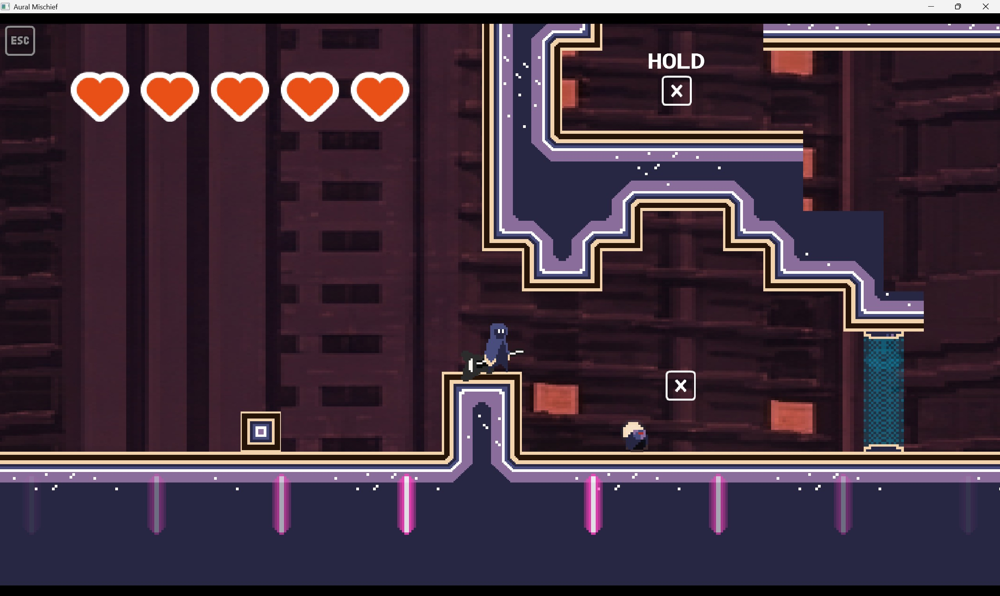
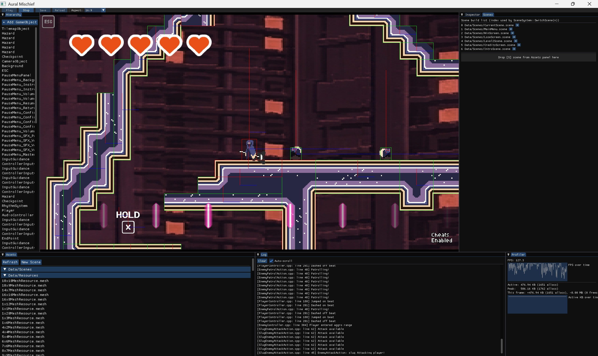
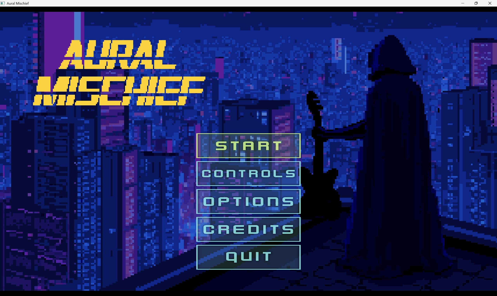
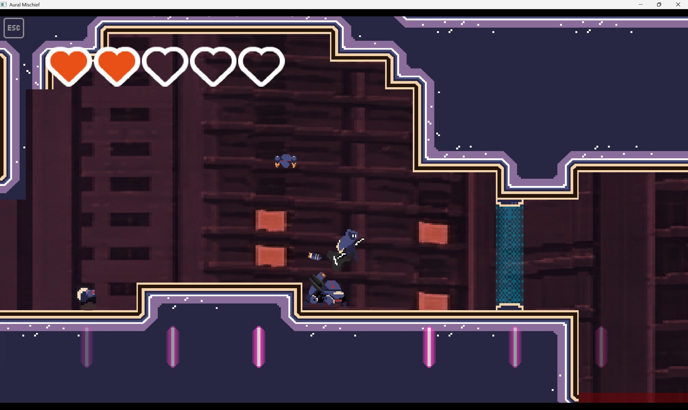

# Mitosis Engine / Aural Mischief — 个人项目贡献

**作者：Jackey Cen（GitHub：Littlecool9）**  
**项目性质：DigiPen Team Olive 团队项目，自研 C++ 引擎与节奏动作平台游戏**  
**个人贡献记录时间：2026 年 1 月至 4 月**  
**公开仓库：[Littlecool9/GAM450Engine](https://github.com/Littlecool9/GAM450Engine)**

## 项目与我的职责

Aural Mischief 运行在团队自研 Mitosis 引擎上。玩家操控持吉他的角色，在平台与敌人构成的关卡中行动，并通过贴合音乐节拍的操作参与战斗和移动。

我在正式交付中署名为 **Game Designer**，实际工作还覆盖引擎基础系统、渲染、UI 编程、关卡设计与打磨。以下依据原仓库中 `Jackey_Cen / Littlecool9` 的 34 次提交、提交差异及最终源码整理。提交数量仅说明记录范围，不代表工作量排名；最终文件也可能经过其他成员继续修改。

## 1. GameObject、组件与场景系统

- 为 GameObject 引入对象标识、Tag 与 Layer，参与 UUID 封装和实体标识重构。
- 实现和调整 GameObjectFactory、ComponentFactory，统一对象与组件的创建入口。
- 调整 GameObject 内存管理，对接项目已有的自定义内存管理设施。
- 实现场景切换相关逻辑，以及跨场景保留对象的 DontDestroy 功能。
- 引入模板 Delegate，为场景变更等事件提供订阅与调用机制。

**工程价值：** 将对象创建、标识与场景生命周期集中管理，让玩法代码复用引擎能力。

源码：[GameObject](Mitosis-Engine/src/Engine/EntitySystem/GameObject/GameObject.h)、[SceneSystem](Mitosis-Engine/src/Engine/SceneSystem/SceneSystem.cpp)、[Delegate](Mitosis-Engine/src/Engine/Delegate/Delegate.h)。原始提交：`744b765`、`63d68eb`、`93eeefa`、`37bd986`。

## 2. 渲染流程与背景视差

我参与重构 Renderer，将 Sprite、Tilemap 等对象的绘制需求统一到渲染命令提交流程，调整精灵、粒子和 Tilemap 的配合方式；同时实现基于相机视图的背景视差与后续背景显示工作。

这是对团队已有渲染器的重构与扩展，整个渲染系统不是我独立开发的。

源码：[Renderer](Mitosis-Engine/src/Engine/Renderer.cpp)、[SpriteRenderer](Mitosis-Engine/src/Engine/EntitySystem/Component/SpriteRenderer.cpp)。原始提交：`6286f73`、`07e17f3`。

## 3. 相机后处理系统

*团队原始技术截图，展示引擎中的关卡与调试环境；不是后处理效果对比图，编辑器全套功能也并非全部由我实现。*

我实现了后处理所需的 Framebuffer、效果抽象与效果栈，把离屏渲染结果依次交给不同效果处理。

- 使用两个 FBO 交替读写，组织多效果与多 Pass 处理。
- 实现颜色染色、亮度/对比度/饱和度调整，以及水平、垂直两次处理的高斯模糊。
- 保存上一帧图像，支持基于帧混合的运动模糊。
- 提供自定义 Shader 效果与参数接口。
- 支持效果启用、移除、排序、参数序列化及 Inspector 编辑。
- 修复启用后处理后，游戏视口尺寸不符合目标尺寸的问题。

**工程价值：** 让视觉效果通过统一效果栈组合和配置，便于游戏与编辑器共同使用。

源码：[Framebuffer](Mitosis-Engine/src/Engine/Renderer/Framebuffer.cpp)、[PostProcessStack](Mitosis-Engine/src/Engine/Renderer/PostProcessStack.cpp)、[PostProcessEffect](Mitosis-Engine/src/Engine/Renderer/PostProcessEffect.cpp)。原始提交：`ff388b1`。

## 4. 菜单、UI 与玩家反馈

*团队原始截图；菜单程序与交互是我的贡献之一，美术和其他素材属于团队成果。*

- 将 UI 从绝对位置调整为相对屏幕布局，修复进入 Play 模式后的按钮响应问题。
- 实现主菜单、淡入与背景表现相关逻辑。
- 通过 JSON 配置按钮 UUID 和导航顺序，支持键盘、手柄、鼠标的焦点切换与高亮。
- 处理主菜单与子面板的输入互斥，避免同一次确认输入触发两层菜单。
- 实现暂停菜单中的恢复游戏、音量调整、返回主菜单确认界面。
- 参与暂停/恢复音乐的接口扩展、血量计算、心形 HUD 及相关修复。

**工程价值：** 将输入、焦点状态、按钮行为与配置数据结合，使菜单能够跨场景和输入设备复用。

源码：[MenuNavigator](AuralMischief/src/Script/MenuNavigator.cpp)、[PauseMenuNavigator](AuralMischief/src/Script/PauseMenuNavigator.cpp)、[PauseMenuPanel](AuralMischief/src/Script/PauseMenuPanel.cpp)、[UITransform](Mitosis-Engine/src/Engine/EntitySystem/Component/UITransform.cpp)。原始提交：`58dd922`、`3ec2917`、`d2b35ea`、`9aadd6d`、`597facc`、`ff57db5`。

## 5. 原型、关卡设计与整合打磨

我参与早期原型的关卡搭建与调整，将平台、敌人、检查点、危险区域组合成可玩的流程，并继续完成 Beta 阶段关卡、第二关和后续关卡迭代。

相关工作还包括调整敌人位置、替换检查点素材、修改地图结构，以及修复 Tilemap 在编辑器 Play/Stop 状态切换后的显示问题。这里的贡献是关卡设计、配置与代码整合，不代表独立开发所有敌人 AI、音乐节拍系统或美术资源。

源码：[正式场景](AuralMischief/Data/Scenes)、[原型归档](archive)。原始提交：`4304c07`、`7cd5551`、`0ceaee5`、`e8a64e2`、`d809b6e`、`d5233ce`、`25c24af`。

## 求职介绍简述

> 在 DigiPen 团队项目 Aural Mischief 中，我兼顾游戏设计与 C++ 引擎、玩法编程。我的贡献包括 GameObject/组件工厂与 UUID 标识、场景切换和跨场景对象保留、渲染命令流程重构、基于 FBO 的相机后处理栈，以及支持键盘、手柄和鼠标的主菜单与暂停菜单。我也参与原型迭代、正式关卡搭建、血量 HUD 和游戏整合打磨。

**技术关键词：** C++20、OpenGL、GLSL、Framebuffer、渲染命令、组件化对象、事件委托、JSON 序列化、Dear ImGui、UI 导航、关卡设计。

## 依据与团队署名

原始提交索引见 [JACKEY_CONTRIBUTIONS.md](docs/JACKEY_CONTRIBUTIONS.md)。原仓库：[DigiPen-GAM5xx/gam541-olive](https://github.com/DigiPen-GAM5xx/gam541-olive)，访问可能受限；分析基准为 `0a4d9db17e6fc1c8448cd9395a8c28e744e4babf`。

团队署名：Rahul Nair（Producer）、Sumin Park（Technical Lead）、Josh Siegel（Graphics Programmer）、Jackey Cen（Game Designer）、Quy Dong Ta（AI Behavior）、Griffin Hart（Composer）。

本仓库是用于作品集的公开源码快照，保留原始版权与第三方许可材料，未新增开源授权。公开仓库保留原主线完整提交历史及原始项目文件，包括团队联系表、交付文档与 GitHub 自动构建配置；原提交 SHA、作者、日期和说明保持不变。作品集介绍作为后续提交加入。截图均来自原始交付，本次未重新编译、运行游戏或进行性能测试。
